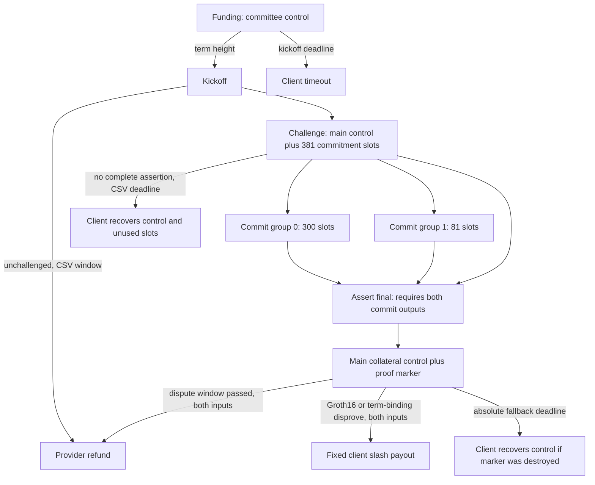

# Storage bond graph with BitVM disputes

The phase-6 proof can now sit behind a storage-bond transaction graph rather than a bridge payout.
The graph commits the actual verifying key's 364 Groth16 disprove leaves and the storage-term binding
leaf, using the same fresh Winternitz public-input key in both. Core 31.1 regtest mined all seven
test scenarios: 32 graph transactions and 32 rejected early, missing-input or invalid-script spends.
The evidence is `results/bitvm-storage-graph-regtest.json`.

This run reuses the checked phase-6 Groth16 proof. Its storage roots, epoch seeds, term journal and
header-chain claim remain that fixture's. The graph uses fresh funding UTXOs, fresh one-time keys and
fresh two-party MuSig2 keys. That seven-case fixture run does not generate fresh proofs or provide
a heavier-chain challenge. A separate same-chain lifecycle now registers keys before funding,
generates the chain, holdings, term and Groth16 proofs on a private VPS, verifies them before
signing, and mines the honest graph through its refund. Its evidence is
`results/bitvm-storage-lifecycle-fresh.json` and `bitvm-storage-lifecycle.md`.

## States and enforced transitions



`storage_graph.rs` builds and presigns these transitions. Control outputs require a two-party MuSig2
signature in a Taproot leaf with a NUMS internal key. Every input uses fresh nonce randomness and
SIGHASH_DEFAULT/ALL. The signatures commit both inputs, the payout, fee budget, sequence and locktime.
Changing the slash destination or substituting another marker invalidates the committee signature.

The default v1 layout has 381 commitment slots: the Groth16 public input, 14 proof-field values, 363 intermediate hashes,
and the claimed tip's height, hash and work. Each slot also has a NUMS internal key. Its commit leaf
requires both the pinned committee transaction signature and the corresponding Winternitz signature;
there is no provider key-path bypass. Its alternate CSV leaf lets the client recover an unspent slot
if the provider stops. The final assertion consumes the main control output and both commit-group
outputs, so it cannot become live without those on-chain commitments.

After the assertion, slashing consumes two outputs: committee-controlled collateral and a proof
marker containing the real verifier/binding leaves. The committee signature fixes the slash payout
to the client. Spending the marker alone cannot redirect the collateral or enable a provider refund.
An absolute client fallback recovers the main control output if someone destroys the marker; an
honest provider must complete its refund before that fallback deadline.

All committee and one-time keys in the harness are generated inside one local setup process. It
receives the funding transaction's fixed txid, presigns the graph, exports only public transaction
vectors, and exits before the harness broadcasts funding. This exercises actual MuSig2 signatures,
but it is not a distributed committee setup or a live provider's proof-generation lifecycle.

## Fresh Core results

| Scenario | Result |
| --- | --- |
| Provider never kicks off | Early timeout rejected; client receives 99,997,000 sats after the deadline |
| Nobody challenges | Early refund rejected; provider receives 99,994,000 sats after the challenge window |
| Challenged provider stays silent | Client receives 92,314,000 sats from control and 7,470,000 from the slots |
| Honest proof and assertion | Skipped commitment and premature finalization rejected; binding disprove rejected; provider receives 98,431,000 sats after the dispute window |
| Genuine proof for a different term | Binding leaf 364 slashes to the client: 96,434,000 sats; redirected slash rejected |
| Corrupted intermediate, correct storage public input | Real Groth16 leaf 181 (`MillerPointOpsStep2`) slashes to the client: 96,434,000 sats; redirected slash rejected |
| Provider destroys the marker of a bad assertion | Refund cannot spend the missing marker; absolute fallback returns 97,431,000 sats of main control to the client |

The harness funds a 100,000,000-sat regtest pot that includes assertion and dispute fees. It uses
short regtest challenge/assert/dispute windows of 6/12/6 blocks. These are separate from the sentinel
bond's CSV 144. The corrupted-intermediate disprove is 869,174 vB and pays a fixed 2,000,000-sat fee;
the example is about graph enforcement, not fee estimation. The node explicitly enables
`acceptnonstdtxn=1` and raises `limitclustersize` to 2000 kB.

Core readback confirms mining. `graph-payouts.ts` separately decodes the exact transaction bytes,
checks their txids against Core's mined txids, and verifies each terminal output pays the intended
client or provider and recovers the main collateral. The test node shuts down after the run.

## Reproduction with existing local dependencies

Build `zk/bitvm-check` with the pinned lockfile. Native Windows MSVC is supported for these tools;
using `CARGO_INCREMENTAL=0` and `CARGO_PROFILE_DEV_DEBUG=0` keeps generated build artifacts smaller.

```text
cargo build --offline --locked --manifest-path zk/bitvm-check/Cargo.toml --bins
bsb-bitvm-check results/bitvm2-spike-groth16 --wrong-public 1 --cache-partials <new-cache> --cache-only
bsb-bitvm-check results/bitvm2-spike-groth16 --wrong-public 1 --assertions-out <new-assertions.json> --assertions-only
node zk/bitvm-check/graph-regtest.ts --bitcoind <installed-bitcoind> --checker <bsb-storage-graph> --partials <cache> --assertions <assertions.json> --dir <new-datadir> --out <new-results.json>
```

The public verifier cache is about 1.1 GB before optional filesystem compression. It fingerprints the
verifying-key file and every script. Graph construction streams each cached script into a leaf hash
instead of retaining the whole tree's script bodies. An explicit `--resume-cache` regenerates and
compares existing bytes before completing an interrupted cache; different contents are rejected.
The assertions-only step executes the actual unsigned verifier chunks before exporting their public
values. The corrupt-proof case signs fresh assertions, constructs a real disprove witness, and spends
that same keyed leaf on Core.

## Next work

The same-chain fresh proof is now connected to the pre-term setup and term-end signing lifecycle
(`bitvm-storage-lifecycle.md`). Add the heavier-chain challenge so
a valid proof of a private fork cannot stand in for the intended chain. Per-epoch deal updates,
distributed committee setup, fee changes and the production Groth16 ceremony remain separate work.
No signet or public-service pilot has run.

## Cumulative-work fork defense: measured requirements

The selected direction is an exact cumulative-work comparison, not the paper's superblock contest.
The current graph has no leaf implementing that comparison. The experiments below constrain its
design; they do not change the funded graph or establish a completed fork defense.

### Comparison must allow an extension of the original claim

`zk/bitvm-check/fork-work-regtest.ts` starts two isolated Core 31.1 nodes and transfers full blocks
through RPC, without connecting peers. They share blocks through height 169, then disagree at the
first storage seed, height 170. The provider's original branch reaches height 220, work 442, and
extends to height 232, work 466. The other node produces three conflicting candidates:

| Candidate | Work | Core's existing honest tip | Independent header verifier |
| --- | --- | --- | --- |
| Height 221 | 444 | Retained | Retained |
| Height 232 | 466 | Retained | Retained |
| Height 233 | 468 | Replaced | Replaced |

`results/bitvm-cumulative-work-forks.json` contains the raw headers and the observed results. Both
branches are validated from genesis; their computed work matches Core, and both nodes stop cleanly.
Regtest work is free, so this tests the comparison mechanism, not Bitcoin's economic security.

The first case refutes `valid(candidate) && conflicting(candidate, oldClaim) &&
candidate.work > oldClaim.work` as a sufficient slash condition. An honest old claim can have a newer,
stronger extension. Equal work also does not establish that an already selected branch must be
replaced; the experiment records this node's incumbent preference, not a universal tie ordering.

A future comparison certificate needs the exact graph/term identity, original claim and a responding
branch extending that claim. Its positive relation should establish all of the following:

1. Both compared branches have valid header-chain proofs under a pinned image and network genesis.
   Each receipt's journal must also name that image. Derive work from validated targets with checked
   arithmetic; do not accept a separate work number from a caller.
2. An authenticated opening proves that the responding branch contains the original tip at its exact
   height. Bind the original height/hash/work to the same term preimage and one-time commitments
   already consumed by the graph. A response cannot silently switch to an unrelated stronger chain.
3. The candidate has strictly more work than that responding branch. Ties cannot authorize slashing
   solely through this relation. Height is not a substitute for work when difficulty changes.
4. Authenticate a divergent block at a common height at or before at least one scheduled seed.
   When both branches reach that seed, its exact-position openings can establish the difference.
   A shorter but higher-work branch also needs a route: prove divergence at a lower common height,
   rather than require an opening above its tip. A fork occurring only after all seed blocks does
   not invalidate those seed bindings. A broader stale-tip forfeiture policy must be explicit.
5. Public input commits every comparison value, proof image, network and graph identity. The Bitcoin
   path must authenticate those same values, not merely accept an off-chain certificate file.

This is a relation between supplied branches. It cannot certify that no unseen stronger branch
exists. The transaction protocol must define when candidates and responses become fixed, how an
honest observer can submit its stronger chain, what happens if either party is silent, and which
confirmation/censorship assumptions its deadlines require. A provider response alone is not a proof
that its branch is globally strongest. Repeated fresh challenges cannot extend the bond indefinitely;
one-shot commitment keys cannot be reused for successive comparisons. None of these rules is yet
enforced by the present graph's 6/12/6-block regression windows.

### Direct header replay does not fit the tested implementation

`zk/bitvm-check/examples/chain-hash-cost.rs` measures the pinned BitVM revision `7d1ca36` and executes
all four SHA table configurations against the native regtest genesis double hash. Each matches.
The measurements exclude linking, difficulty, timestamps, work arithmetic, authentication, fork
openings and transaction overhead:

| Add table | Full XOR table | Bytes per double hash | Bytes for 33 headers | Maximum stack items |
| --- | --- | ---: | ---: | ---: |
| No | No | 839,589 | 27,706,437 | 516 |
| Yes | No | 722,907 | 23,855,931 | 676 |
| No | Yes | 749,253 | 24,725,349 | 636 |
| Yes | Yes | 632,571 | 20,874,843 | 796 |

`results/bitvm-chain-hash-cost.json` records the executable measurements. Even the smallest tested
33-header hashing program exceeds a Bitcoin block. This rules out that direct single-transaction
implementation, not every possible SHA optimization or a future protocol spanning transactions.

### Remaining enforcement problem

The experimental RISC Zero fork guest now proves the exact relative-work comparison using three
genuine header receipts and authenticated original-tip and divergence openings (see below).
Its certificate still needs a Bitcoin-enforced route to the collateral. The current BitVM graph
optimistically verifies the provider's fixed-key assertion and lets anyone expose a false chunk.
That is different from accepting a new challenger's positive certificate and making it binding.

Before adding a slash leaf, specify and test how the candidate, responding branch, public input and
execution trace become authenticated across the presigned transactions. An off-chain Groth16 check
does not supply this binding. A second optimistic assertion with newly chosen challenger keys needs
its own graph and a sound way to bind those keys to the collateral. Requiring the original client to
hold all challenger commitment secrets would add a designated online role; revealing those secrets
would allow forged intermediate assertions. Neither is an implementation of permissionless defense.

The next protocol experiment should demonstrate that binding with a small exact comparison program
before paying to generate another full Groth16 verifier tree. Its Core tests must reject substituted
candidate/response data, unrelated response branches, invented work, equal-work slashes, stale
comparison replay and redirected payouts, while preserving an honest provider's extension response
and permitting an observer who did not participate in setup to challenge.

For context, the [BitVM2 paper](https://bitvm.org/bitvm_bridge.pdf) uses a timed superblock contest;
the pinned `bridge/src/connectors/connector_b.rs` leaf compares an individual candidate header hash
with the operator's committed superblock hash. That path is not an exact cumulative-work verifier.
[BitVM2's description](https://bitvm.org/bitvm2) distinguishes permissionless fraud challenges from
the earlier fixed-verifier design. These are relevant design constraints, not missing code that can
be enabled by renaming a connector. Core's [v31.1 mining RPC source](https://github.com/bitcoin/bitcoin/blob/v31.1/src/rpc/mining.cpp)
also explains why `submitblock` may return `inconclusive` for a stored side branch; the harness checks
header readback and eventual actual tip adoption rather than treating that status as an invalid block.

Reproduce with the already installed dependencies:

```text
cargo run --offline --locked --manifest-path zk/bitvm-check/Cargo.toml --example chain-hash-cost
node zk/bitvm-check/fork-work-regtest.ts --bitcoind <installed-bitcoind> --dir <new-data-dir> --out <new-report.json>
```

### Input-binding experiments on Core

`zk/bitvm-check/input-binding-regtest.ts` and the Rust `input-binding` example test three small
designs on isolated Core 31.1. These deliberately use a scalar inequality and arbitrary 32-byte
tags; they do not verify headers or ZK proofs. The ephemeral presigner exits before funding is
broadcast, and the harness chooses its arbitrary tags only afterwards.

* Ordinary witness data: a parent announces `(444, tag A)`, but its child can supply `(468, tag B)`
  and satisfy the local `work > 466` check. Core mines both transactions. Both parent witness
  variants have the same txid and different wtxids; signing the descendant's parent outpoint does
  not authenticate the parent's ordinary witness. This reproduces a missing binding in the toy
  design, not a vulnerability in the existing WOTS-bound storage graph.
* Fixed commitment control: both scripts require the setup's `(468, fixed tag)`. Core mines the
  matching parent and response; changed tags, changed work and a redirected payout are rejected.
  This control binds input correctly, but fixes the input before the challenger observes a fork.
* Output commitment: changing a presigned parent's data output changes its txid and invalidates
  its signature. An independently presigned alternative parent can be mined, but its old descendant
  has missing inputs; rewiring that descendant to the alternative parent invalidates its signature.

`results/bitvm-input-binding.json` records five mined transactions, nine rejected spends and the
actual public transaction bytes. The node stops cleanly. These results rule out these unbound
shortcuts; they do not prove that every permissionless input-binding construction is impossible.
The relevant [Taproot signature rules](https://github.com/bitcoin/bips/blob/master/bip-0341.mediawiki)
commit transaction data and spending context; they do not make a child's outpoint identify a unique
parent witness. [BitVMX's message linking](https://bitvmx.org/knowledge/bitvmx-a-cpu-for-universal-computation-on-bitcoin)
instead uses one-time keys fixed during setup. Its two-party construction is useful context, but
does not by itself supply an after-setup challenger's positive certificate path for this graph.

```text
cargo build --offline --locked --manifest-path zk/bitvm-check/Cargo.toml --example input-binding
node zk/bitvm-check/input-binding-regtest.ts --bitcoind <installed-bitcoind> --checker <input-binding-example> --dir <new-data-dir> --out <new-report.json>
```

### Relative-work certificate and Groth16 wrap

The experimental `methods/fork` guest now proves the relative comparison using three authenticated
header-chain receipts: the original claim, its responding extension, and the competing candidate.
It pins the regtest header image and genesis, checks each MMR's shape and tip, checks the original
tip's exact-position membership in the response, and authenticates a divergent block at or before
a selected storage seed. Its work comparison is a strict comparison of the receipts' big-endian
256-bit cumulative work. The 202-byte term preimage must name that original tip, hash and work.

The certificate commits a 354-byte statement: domain, graph identifier, term-journal digest, the
three height/hash/work triples, epoch index, divergence height, and the two divergent block hashes.
The guest's 32-byte journal is SHA256 of those bytes. `fork_relation.rs` defines the layout;
`check_fork_research.py` independently reconstructs it from the full header files and validates
regtest linking, difficulty, PoW, version and median-time rules. Receipt verification is a separate,
explicit operation of that checker. `check-fork-public.ts` independently recomputes the wrapper's
SHA256/BLAKE3 public input, including the new guest image rather than the holdings or term image.

The VPS job proved the captured experiment's work values `442 < 466 < 468`, and wrapped the
certificate using the existing pinned Groth16 image and verifying key:

* Fork image: `8cf297b91e31b0ee52b57c876888f120416950ab3e7169d26c7315751da39457`.
* Certificate journal: `d78d19d832272aafd9def1236f0c636af020de106ad7ef2e9e2cc75eac40209c`.
* Groth16 public input: `331922694518165887603772562130688070796909051370644513024791622746851652422`.

The certificate evidence is `results/bitvm-cumulative-work-certificate.json`; its Groth16 proof,
public input and verifying key are in `results/bitvm-cumulative-work-groth16/`.

The complete BitVM interpreter run also passes (`results/bitvm-cumulative-work-verifier.json`).
All 364 honest disprove scripts fail as intended. A wrong public input is disproved at leaf 363
(955,010 bytes with witness, maximum stack 744), and a corrupted intermediate at leaf 181
(3,475,684 bytes, maximum stack 946). The run took 19:29.97 and peaked at 4,883,776 KiB RSS on the VPS.

The standalone checker now rejects an invalid pairing control, missing disprove, failed disprove,
or recorded resource-limit violation. Its `--audit-report <file>` mode applies those outcome checks
to an existing report without repeating the expensive verifier run; it does not verify a proof
from a JSON report. Five adversarial tests cover absent, false, mistyped and inconsistent results.

The existing holdings, term and header-chain image IDs remain unchanged. Seven native relation
tests and nine compiled-guest/prover rejection cases cover malformed bindings and invented work.
Independent readback has sixteen checks, including actual receipt verification and rejection of
changed receipt bytes. The native pairing checker accepts the new Groth16 proof and rejects a
replayed storage proof, a changed guest image and a changed graph identity.

This dataset uses the two-node fork experiment and a synthetic graph identifier. It generates no
holdings proof for those experimental branches and attaches no comparison to a funded bond. The
certificate proves a relationship between supplied branches; the challenge/response timing and
collateral-spending protocol described above remain implementation work. The original same-chain
funded storage proof remains the separate lifecycle milestone.

Reproduce with the existing pinned tools. Run the heavy proving commands on a suitable machine;
the recipe starts no Bitcoin node, signer or downloader:

```text
node zk/risc0/prepare-fork-inputs.mjs . <new-input-dir>
bash zk/risc0/build-pinned.sh <installed-cargo> <populated-guest-cargo-home> <new-wrapper-dir>
bash zk/risc0/prove-fork-research.sh <input-dir> <new-proof-dir> <bsb-r0> <pinned-regtest-header-elf>
python3 zk/risc0/check_fork_research.py <input-dir> <proof-dir> --receipt-verifier <bsb-r0>
python3 zk/risc0/check_fork_research_test.py --inputs <input-dir> --output <proof-dir> --receipt-verifier <bsb-r0>
bsb-r0 groth16-fork <proof-dir>/fork.bin <new-g16-dir>
```

`groth16-fork` requires the fork image and an already installed pinned Docker image, and refuses
an existing output directory. The original `groth16` command continues to require the term image.
Copy the pinned `results/bitvm2-spike-groth16/vk.json` into the new Groth16 directory, save the
independent readback result, then check the public input and pairings:

```text
node zk/risc0/check-fork-public.ts --g16 <g16-dir> --readback <readback.json> --out <new-public-report.json>
node zk/risc0/fork-public-guards.ts --g16 <g16-dir> --statement <proof-dir>/fork.bin.statement.bin --checker <bsb-bitvm-check> --dir <new-guard-dir> --out <new-guard-report.json>
bsb-bitvm-check <g16-dir> --wrong-public 1 --out <new-full-check.json> --assertions-out <new-assertions.json>
```

The final command executes the full BitVM verifier and its disprove checks. Its public one-time
test keys are suitable for interpreter experiments. A transaction graph needs its own authenticated
commitments and signatures before any of these checks can control collateral.

### Compact binding arithmetic

The proved v1 certificate is not yet a usable Bitcoin input binding. With the current SHA
implementation, hashing its 354-byte public statement exceeds the interpreter's 1,000-item stack
limit. Independently signing every v1 field would also start with 1,440 witness items. These are
measurements of these implementations, not an impossibility result for other encodings.

A proposed v2 public projection keeps the domain, graph identity, original term-journal digest,
response height/hash/work and candidate height/hash/work: 214 bytes. The original triple is already
committed by the term journal. Epoch and divergence evidence may become private witnesses only
if the new guest retains every original membership, seed-divergence and strict-work check.
A separate compact guest now proves this projection, as recorded below. The proved v1 image is unchanged.

`fork_binding.rs` verifies eight setup-pinned WOTS signatures and recomputes that projection's
SHA256/BLAKE3 wrapper input. Its complete arithmetic uses 1,241,447 script bytes and a maximum of
853 stack items, including signature verification. The initial signature witness has 844 items.
The honest case reaches false; each of eight independently signed field substitutions opens the
disprove leaf. Changed setup identity, changed wrapper constants, an unrelated signing key and a
noncanonical BN254 scalar alias are also tested. The initial prototype used dummy wrapper constants. The current tests use the genuine compact
certificate and its exact Groth16 public input. The v1 proof is a separate statement.

The `disprove_term_binding_with_journal` component binds the provider's signed original term
journal to the same 202-byte term and storage public input. It uses 1,232,157 bytes and at most 792
stack items. The optional v2 storage setup now includes this leaf and a 382nd on-chain commitment
slot; Core mined the honest refund, bad-journal slash and silent-provider recovery. An omitted
journal signature is rejected. The evidence is `results/bitvm-storage-journal.json`, with setup
and attachment details in `bitvm-storage-lifecycle.md`. This regression uses the phase-6 proof;
the existing fresh-chain proof uses v1. The original storage binding remains 1,223,886 bytes and
760 stack items.

This binds the provider's own storage assertion. It does not safely bind a challenger to that
provider's earlier value: the provider owns the secret and can sign another journal. Reusing its
key in the challenger's binding could let it manufacture a mismatch against an honest challenger.
A cross-party graph requires authenticated values or an explicit equivocation penalty that stays
funded, with an enforceable response window before withdrawal. Key reuse alone is insufficient.

`results/bitvm-fork-binding-arithmetic.json` records the measurements and twenty passing library
tests. The resource probe is `examples/fork-binding-cost.rs`. The compact fork binding remains an
isolated arithmetic/Core experiment; only the provider journal component is integrated into the
optional v2 storage graph. Existing funded v1 graphs cannot be retrofitted. Challenger registration,
input ownership, deadlines and fork collateral enforcement remain protocol work.

The [BATTLE for Bitcoin paper, sections 2.4, 2.8.1 and 2.9.3](https://arxiv.org/html/2510.06468v1)
provides a useful exact-work comparison design: dual counterproofs, or signed work scores linked
to separately verified proofs. Its key exchange and challenger permutation are established during
setup. Its score-carry variant also leaves a both-valid outcome requiring a persistent bond.
These details matter before adapting its payout logic. My assessment is that its presented graph
does not directly resolve registration of a previously unknown challenger in this storage graph;
that stronger property still needs an explicit construction and adversarial transaction tests.

### Proved compact certificate

The separate `methods/fork_compact` guest calls the complete v1 predicate and publishes the 214-byte
projection. The original-tip membership, eligible epoch and authenticated seed divergence remain
checked inside the guest. The public statement now proves that an eligible divergent seed exists;
it does not expose a particular epoch or divergence position. A protocol that requires a specific
publicly selected epoch must bind that choice separately.

The genuine VPS run reused the three already proved header-chain receipts and generated a fresh
compact certificate and Groth16 wrap. The original holdings, term, header-chain and v1 fork image
IDs reproduce unchanged. Seven paired native tests compare both predicates' acceptance/rejection
and the exact projected layout; nine compiled-guest/prover rejection cases and sixteen independent
readback checks pass. The latter include fresh seal verification and rejection of altered receipt
bytes. The v1 verifier rejects the compact receipt, and the compact wrapper rejects the v1 receipt
before creating an output directory.

* Compact image: `b1766c1d9ebf071acd684ea744d83908181a60d313ccb385661e3fe76ff855b1`.
* Compact journal: `68df3b15df54d3e287908949c9607d0ffb0ac7e60ee7a1d433c2944ab1dbe0a7`.
* Groth16 public input: `440360104829126912423372908572745653223447774026933459930022392504055569461`.

`results/bitvm-cumulative-work-compact.json` records the proof, timings and independent checks;
`results/bitvm-cumulative-work-compact-groth16/` contains the public wrap. The certificate took
4:26.58 and peaked at 2,408,124 KiB RSS. Wrapping took 3:13.47; its host RSS measurement excludes
the Docker container. Header proving was reused, so these times are not an end-to-end fresh-header run.

Native pairings accept the compact proof and reject a storage-proof replay, v1-fork-proof replay,
wrong guest image and wrong graph identity. The Bitcoin binding tests use this actual proof's public
input and wrapper constants. The complete compact binding remains 1,241,447 bytes with maximum stack
853; all twenty library tests pass, including field substitutions and a noncanonical scalar alias.
The compact proof now also passes the full 364-script BitVM verifier
(`results/bitvm-compact-cumulative-work-verifier.json`). All honest disprove scripts fail, and the
separate honest assertion validator finds no error. The wrong-public-input disprove executes at
leaf 363 (955,010 script-plus-witness bytes, maximum stack 744); the corrupted-intermediate disprove
executes at leaf 181 (3,475,684 bytes, maximum stack 946). Both remain within the measured resource
budgets. The VPS run took 18:42.63 and peaked at 4,884,512 KiB RSS.

This run compiled the fail-closed outcome gate before verification, passed all twenty native library
tests on the VPS, and audited the completed report again locally. The returned assertions name this
compact certificate's exact public scalar and contain fourteen field values and 363 intermediate
hashes. Result and assertion-file hashes match the producer's checksum record. These are full BitVM
interpreter results; the distinct Core component checks below exercise actual Taproot spends.
The existing verifying key still comes from the pinned testing setup.

The proof's graph identifier is synthetic, its branches have no corresponding holdings proof in
this experiment, and the binding is not registered in a funded graph. No challenger-role assumption
has been changed: the after-setup, permissionless fork-to-collateral path remains unresolved.

Reproduce with cached tools and the original experiment's header receipts:

```text
bash zk/risc0/build-pinned.sh <installed-cargo> <populated-guest-cargo-home> <new-wrapper-dir>
bash zk/risc0/prove-fork-compact.sh <input-dir> <v1-proof-dir> <new-proof-dir> <bsb-r0>
python3 zk/risc0/check_fork_research.py <input-dir> <proof-dir> --compact --receipt-verifier <bsb-r0>
python3 zk/risc0/check_fork_research_test.py --compact --inputs <input-dir> --output <proof-dir> --receipt-verifier <bsb-r0>
bsb-r0 groth16-fork-compact <proof-dir>/fork.bin <new-g16-dir>
node zk/risc0/check-fork-public.ts --compact --g16 <g16-dir> --readback <readback.json> --out <new-public-report.json>
node zk/risc0/fork-public-guards.ts --compact --g16 <g16-dir> --statement <proof-dir>/fork.bin.statement.bin --checker <bsb-bitvm-check> --dir <new-guard-dir> --out <new-guard-report.json>
```

Save the independent readback as `<readback.json>` and copy the pinned verifying key into the
Groth16 directory before the final two checks. The recipe starts no Bitcoin node or downloader.

### Late marker attachment: flexible signatures do not authenticate the verifier

`examples/late-marker.rs` and `late-marker-regtest.ts` test whether a challenger created after
setup can attach a new proof-marker input to an existing collateral spend. This is a deliberately
incomplete design, using a small work comparison and hash tag rather than headers or Groth16.
A single ephemeral signing key stands in for committee authorization solely to test the sighash
rules; it exports public templates and exits before funding. Only afterwards does a separate
process generate the challenger's key and tag, construct its marker, and sign its own input.

| Collateral signature | Observed result on Core 31.1 |
| --- | --- |
| `SINGLE|ANYONECANPAY` | Admits the intended late marker, an `OP_TRUE` replacement, and no marker |
| `ALL|ANYONECANPAY` | Pins all outputs, but likewise admits either replacement or omission |
| `SIGHASH_DEFAULT`, fixed marker input | Accepts its original marker and rejects changed or omitted marker inputs |
| Either flexible signature, annex added later | Rejects with `Invalid Schnorr signature` |

The intended marker independently rejects equal work and a changed tag, so its predicate is tested
rather than assumed. Both flexible collateral signatures also reject a redirected payout. These
controls distinguish failure to authenticate the extra verifier input from failure to bind the
recipient. Core mines the trivial-marker substitution, marker omission, and strict original control;
each pays the pinned client 99,995,000 regtest sats. Seven admission checks and twelve rejected
spends are recorded in `results/bitvm-late-marker-attachment.json`. Public templates and the late
challenger's transaction vectors are in `results/bitvm-late-marker-vectors.json`. An independent
`check_late_marker.py` audit recomputes txids and wtxids, checks the original signatures are reused
byte for byte, and verifies the fixed payouts and actual sighash bytes. The node is isolated
and exits cleanly.

This rules out merely loosening the present collateral signature to permit an arbitrary future
marker. It does not demonstrate a flaw in the existing graph, which uses fixed inputs and
`SIGHASH_DEFAULT/ALL`, nor prove that every possible permissionless registration protocol fails.
The [BIP341 signature message](https://github.com/bitcoin/bips/blob/master/bip-0341.mediawiki#common-signature-message)
authenticates the signing input under `ANYONECANPAY`; other inputs need their own authentication
mechanism. It also commits an annex when present, including its presence bit. The measured annex
rejection therefore prevents using a newly attached annex as an already-presigned data commitment.

```text
cargo build --offline --locked --manifest-path zk/bitvm-check/Cargo.toml --example late-marker
node zk/bitvm-check/late-marker-regtest.ts --bitcoind <installed-bitcoind> --checker <late-marker-example> --dir <new-data-dir> --out <new-report.json>
python3 zk/bitvm-check/check_late_marker.py <new-report.json> <new-data-dir>/public-vectors.json
```

### Other cryptographic enforcement research

The [ColliderScript authors' construction](https://eprint.iacr.org/2024/1802.pdf) demonstrates why
these failed attachment experiments are not an impossibility proof. It proposes no-fork transaction
introspection using collision searches, with about `2^86` hash queries per spend in the cited design.
That is a separate cryptographic construction, not a practical cached component of this graph.

[PIPEs v2, sections 1.1 and 2.6](https://www.allocinit.xyz/uploads/pipesv2.pdf) instead considers
extractable witness encryption and one-time key release. Key release alone does not constrain the
subsequent transaction's outputs or messages. Its cited [AADP instantiation](https://eprint.iacr.org/2026/175)
estimates hundreds of terabytes of ciphertext at 100-bit security. These are research estimates,
not measured capabilities of the rented VPS or this repository.

Adapting such a primitive would require an explicit relation authenticating the provider's actual
term and responding claim under the graph's existing keys, plus an independently enforced payout
and deadline protocol. Ordinary false-instance witness-encryption security would not suffice for
a hard but satisfiable authorization relation; the cited PIPE model explicitly asks for extractability.
No such primitive or changed security assumption has been adopted here. The current exact-work
certificate remains useful, but its permissionless path into the collateral is still unimplemented.

### Compact binding consensus checks on Core

`bsb-fork-binding` and `fork-binding-regtest.ts` now exercise the compact arithmetic leaf as a real
Taproot spend on isolated Core 31.1. Each of thirteen cases uses fresh one-time keys; the vector
producer exits before funding is broadcast. The honest binding reaches false and cannot slash.
An unrelated signing key fails its WOTS check. Eleven validly signed mismatches are accepted and
mined: every committed field, the graph identity, wrapper constants, and a noncanonical public-scalar
alias. Each witness starts with 844 signature items, excluding its script and control block.

`results/bitvm-compact-fork-binding-regtest.json` records the mined txids, Core-read transaction sizes
and policy settings, plus the hash of the public vector archive. The node stops cleanly. The large
leaf requires nonstandard relay policy. This is an isolated arithmetic component; its payout is not
committee-pinned, and it neither registers a new challenger nor enforces a fork dispute on the funded
bond. The scope remains separate from the full Groth16 BitVM verifier and from the current graph.

```text
cargo build --offline --locked --manifest-path zk/bitvm-check/Cargo.toml --bin bsb-fork-binding
node zk/bitvm-check/fork-binding-regtest.ts --bitcoind <installed-bitcoind> --checker <bsb-fork-binding> --dir <new-data-dir> --out <new-report.json>
```
