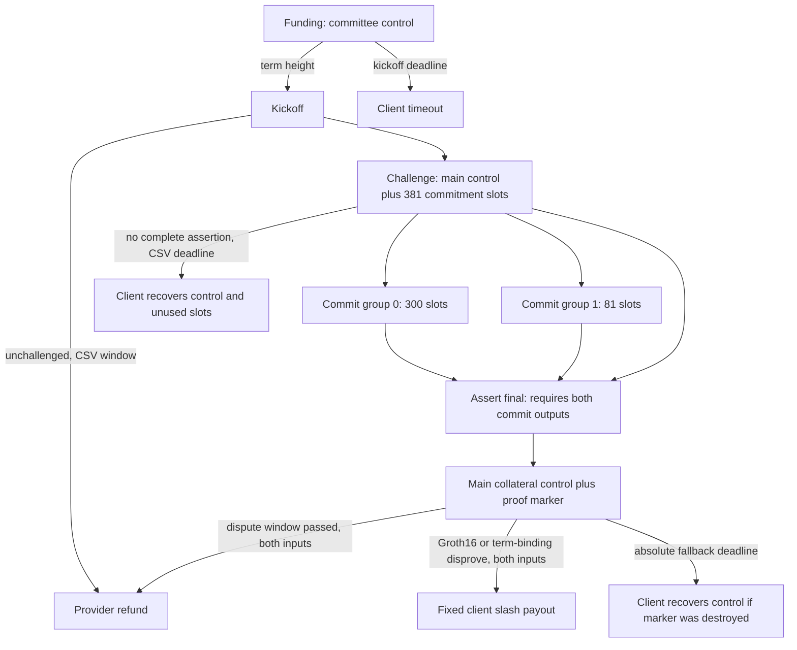

# Storage bond graph with BitVM disputes

The phase-6 proof can now sit behind a storage-bond transaction graph rather than a bridge payout.
The graph commits the actual verifying key's 364 Groth16 disprove leaves and the storage-term binding
leaf, using the same fresh Winternitz public-input key in both. Core 31.1 regtest mined all seven
test scenarios: 32 graph transactions and 32 rejected early, missing-input or invalid-script spends.
The evidence is `results/bitvm-storage-graph-regtest.json`.

This run reuses the checked phase-6 Groth16 proof. Its storage roots, epoch seeds, term journal and
header-chain claim remain that fixture's. The graph uses fresh funding UTXOs, fresh one-time keys and
fresh two-party MuSig2 keys. It does not yet generate new storage/header proofs against this run's
chain or provide a heavier-chain challenge.

## States and enforced transitions



`storage_graph.rs` builds and presigns these transitions. Control outputs require a two-party MuSig2
signature in a Taproot leaf with a NUMS internal key. Every input uses fresh nonce randomness and
SIGHASH_DEFAULT/ALL. The signatures commit both inputs, the payout, fee budget, sequence and locktime.
Changing the slash destination or substituting another marker invalidates the committee signature.

The 381 commitment slots are the Groth16 public input, 14 proof-field values, 363 intermediate hashes,
and the claimed tip's height, hash and work. Each slot also has a NUMS internal key. Its commit leaf
requires both the pinned committee transaction signature and the corresponding Winternitz signature;
there is no provider key-path bypass. Its alternate CSV leaf lets the client recover an unspent slot
if the provider stops. The final assertion consumes the main control output and both commit-group
outputs, so it cannot become live without those on-chain commitments.

After the assertion, slashing consumes two outputs: committee-controlled collateral and a proof
marker containing the real verifier/binding leaves. The committee signature fixes the slash payout
to the client. Spending the marker alone cannot redirect the collateral or enable a provider refund.
An absolute client fallback recovers the main control output if someone destroys the marker; an
honest provider must complete its refund before that fallback deadline.

All committee and one-time keys in the harness are generated inside one local setup process. It
receives the funding transaction's fixed txid, presigns the graph, exports only public transaction
vectors, and exits before the harness broadcasts funding. This exercises actual MuSig2 signatures,
but it is not a distributed committee setup or a live provider's proof-generation lifecycle.

## Fresh Core results

| Scenario | Result |
| --- | --- |
| Provider never kicks off | Early timeout rejected; client receives 99,997,000 sats after the deadline |
| Nobody challenges | Early refund rejected; provider receives 99,994,000 sats after the challenge window |
| Challenged provider stays silent | Client receives 92,314,000 sats from control and 7,470,000 from the slots |
| Honest proof and assertion | Skipped commitment and premature finalization rejected; binding disprove rejected; provider receives 98,431,000 sats after the dispute window |
| Genuine proof for a different term | Binding leaf 364 slashes to the client: 96,434,000 sats; redirected slash rejected |
| Corrupted intermediate, correct storage public input | Real Groth16 leaf 181 (`MillerPointOpsStep2`) slashes to the client: 96,434,000 sats; redirected slash rejected |
| Provider destroys the marker of a bad assertion | Refund cannot spend the missing marker; absolute fallback returns 97,431,000 sats of main control to the client |

The harness funds a 100,000,000-sat regtest pot that includes assertion and dispute fees. It uses
short regtest challenge/assert/dispute windows of 6/12/6 blocks. These are separate from the sentinel
bond's CSV 144. The corrupted-intermediate disprove is 869,174 vB and pays a fixed 2,000,000-sat fee;
the example is about graph enforcement, not fee estimation. The node explicitly enables
`acceptnonstdtxn=1` and raises `limitclustersize` to 2000 kB.

Core readback confirms mining. `graph-payouts.ts` separately decodes the exact transaction bytes,
checks their txids against Core's mined txids, and verifies each terminal output pays the intended
client or provider and recovers the main collateral. The test node shuts down after the run.

## Reproduction with existing local dependencies

Build `zk/bitvm-check` with the pinned lockfile. Native Windows MSVC is supported for these tools;
using `CARGO_INCREMENTAL=0` and `CARGO_PROFILE_DEV_DEBUG=0` keeps generated build artifacts smaller.

```text
cargo build --offline --locked --manifest-path zk/bitvm-check/Cargo.toml --bins
bsb-bitvm-check results/bitvm2-spike-groth16 --wrong-public 1 --cache-partials <new-cache> --cache-only
bsb-bitvm-check results/bitvm2-spike-groth16 --wrong-public 1 --assertions-out <new-assertions.json> --assertions-only
node zk/bitvm-check/graph-regtest.ts --bitcoind <installed-bitcoind> --checker <bsb-storage-graph> --partials <cache> --assertions <assertions.json> --dir <new-datadir> --out <new-results.json>
```

The public verifier cache is about 1.1 GB before optional filesystem compression. It fingerprints the
verifying-key file and every script. Graph construction streams each cached script into a leaf hash
instead of retaining the whole tree's script bodies. An explicit `--resume-cache` regenerates and
compares existing bytes before completing an interrupted cache; different contents are rejected.
The assertions-only step executes the actual unsigned verifier chunks before exporting their public
values. The corrupt-proof case signs fresh assertions, constructs a real disprove witness, and spends
that same keyed leaf on Core.

## Next work

Connect a fresh term proof and chain claim from the same lifecycle run to this graph. The separate
setup and term-end signing processes are now tested with the phase-6 proof
(`bitvm-storage-lifecycle.md`). Add the heavier-chain challenge so
a valid proof of a private fork cannot stand in for the intended chain. Per-epoch deal updates,
distributed committee setup, fee changes and the production Groth16 ceremony remain separate work.
No signet or public-service pilot has run.
